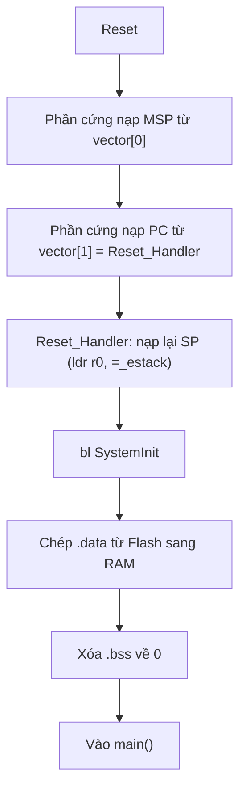

# Lab 1: Startup code và Vector table (STM32F405RG)

Lab đầu tiên trong series `cortex-m-labs`. Mục tiêu là hiểu chuyện gì xảy ra từ lúc cấp nguồn đến khi vào `main()`, và kiểm chứng bằng số liệu thật đọc từ debugger.

## Mục tiêu

- Đọc được vector table trong Flash và giải thích từng phần tử đầu.
- Hiểu `Reset_Handler` chuẩn bị gì để code C chạy được (SP, `.data`, `.bss`).
- Thấy tận mắt giá trị biến toàn cục trước và sau khi startup chạy.

## Môi trường

| Hạng mục | Chi tiết |
|---|---|
| MCU | STM32F405RG (Cortex-M4F) |
| Debugger | ST-Link V2 (WeAct), giao tiếp SWD |
| IDE | STM32CubeIDE |
| Cách lập trình | Không dùng HAL, chỉ code C và startup mặc định |

## Code thử nghiệm

```c
#include <stdint.h>

volatile uint32_t g_init = 0xDEADBEEF;   // nằm trong .data
volatile uint32_t g_zero;                // nằm trong .bss

int main(void)
{
    uint32_t a = g_init;   // tham chiếu để linker không loại bỏ biến
    uint32_t b = g_zero;
    (void)a; (void)b;

    for (;;);
}
```

## Trình tự khởi động



Thứ tự này lấy từ file startup của project: `SystemInit` chạy **trước** khi `.data` và `.bss` được khởi tạo, nên nó không được dựa vào biến toàn cục đã khởi tạo.

## Kết quả đo

### Vector table (đọc từ Memory view tại `0x08000000`)

Memory view hiển thị từng byte theo thứ tự địa chỉ. STM32 là little-endian nên phải đảo byte để ra giá trị 32-bit.

|           Vị trí         |  Hiển thị  | Giá trị thật |                     Ý nghĩa                       |
|--------------------------|------------|--------------|---------------------------------------------------|
| `0x08000000` (vector[0]) | `00000220` | `0x20020000` |    Giá trị SP ban đầu (đỉnh vùng RAM chính)       |
| `0x08000004` (vector[1]) | `E9010008` | `0x080001E9` | Địa chỉ `Reset_Handler` (`0x080001E8`), bit 0 = 1 |
| `0x08000008` trở đi      | `39020008` | `0x08000239` | Phần lớn trỏ về `Default_Handler` (`0x08000238`)  |


### Địa chỉ trong file `.map`

| Symbol | Địa chỉ | Ghi chú |
|---|---|---|
| `g_pfnVectors` (`.isr_vector`) | `0x08000000`, dài `0x188` byte | 98 phần tử = 16 hệ thống + 82 IRQ |
| `main` | `0x080001C8`, dài `0x20` byte | |
| `Reset_Handler` | `0x080001E8`, dài `0x50` byte | `vector[1]` phải là `0x080001E9` (bit 0 = 1) |
| `Default_Handler` | `0x08000238` | Vector mặc định trỏ `0x08000239` |
| `_estack` | `0x20020000` | `ORIGIN(RAM) + LENGTH(RAM)`, bằng `vector[0]` |
| `_sidata` | `0x080002A4` | LMA của `.data`: nơi lưu giá trị khởi tạo trong Flash |
| `_sdata` / `_edata` | `0x20000000` / `0x20000004` | VMA của `.data` trong RAM, dài 4 byte |
| `g_init` | `0x20000000` | Nằm trong `.data`, 4 byte |
| `_sbss` / `_ebss` | `0x20000004` / `0x20000024` | Vùng `.bss`, dài `0x20` byte |
| `g_zero` | `0x20000020` | Nằm trong `.bss`; `0x1C` byte đầu của `.bss` thuộc `crtbegin.o` |

Tổng Flash dùng: `0x2A8` = 680 byte. RAM tĩnh (`.data` + `.bss`): `0x24` = 36 byte.

### Thanh ghi sau lệnh đầu tiên của `Reset_Handler`

Chụp khi PC = `0x080001EA`: lệnh `ldr r0, =_estack` đã chạy, lệnh `mov sp, r0` chưa chạy.

| Thanh ghi | Giá trị | Nhận xét |
|---|---|---|
| PC | `0x080001EA` (`Reset_Handler` + 2) | Lệnh đầu (16-bit) tại `0x080001E8` vừa chạy xong |
| R0 | `0x20020000` | Vừa được nạp bởi `ldr r0, =_estack` |
| MSP / SP | `0x20020000` | Bằng `vector[0]`, do phần cứng nạp |
| PSP | `0x0` | Chưa dùng |
| CONTROL | `0` | Đang dùng MSP, thread mode có đặc quyền |
| xPSR | `0x01000000` (hiển thị `16777216`) | Bit 24 (T) = 1, trạng thái Thumb |
| LR | `0xFFFFFFFF` (hiển thị `-1`) | Giá trị LR sau reset |
| R1-R12 | `0` | Chưa được dùng |
| PRIMASK / BASEPRI / FAULTMASK | `0` | Không che ngắt nào |

SP đã bằng `0x20020000` trong khi lệnh `mov sp, r0` (tại `0x080001EA`) chưa chạy. Vậy SP do phần cứng nạp từ `vector[0]` khi reset, hai lệnh đầu của `Reset_Handler` chỉ nạp lại cho chắc.

### Giá trị biến trước và sau khi chạy tới `main()`

Tại `Reset_Handler`, RAM chưa được khởi tạo nên hai biến chứa giá trị rác (có thể khác nhau giữa các lần chạy).

| Biến | Tại đầu `Reset_Handler` | Tại `main()` | Kết quả mong đợi |
|---|---|---|---|
| `g_init` | `0xBE00` (rác) | `0xDEADBEEF` | `0xDEADBEEF` |
| `g_zero` | `0x60015155` (rác) | `0` | `0` |


### Kiểm chứng giá trị khởi tạo trong Flash

Memory view tại `0x080002A4` (`_sidata`) hiển thị `EFBEADDE`, đảo byte ra `0xDEADBEEF`. Đây là giá trị mà `Reset_Handler` chép sang `g_init` trong RAM. Từ `0x080002A8` trở đi là `FFFFFFFF` (Flash chưa ghi), khớp với tổng dung lượng image `0x2A8`.

## Trả lời câu hỏi

### 1. Vì sao `vector[1]` là số lẻ?

Trong bộ nhớ là `0x080001E9` còn `Reset_Handler` thật nằm ở `0x080001E8`. Bit 0 = 1 là cờ Thumb. Cortex-M chỉ chạy tập lệnh Thumb, và khi nạp địa chỉ vào PC (reset, exception, `BX`/`BLX`) thì bit 0 được chép vào bit T của xPSR. Nếu bit 0 = 0 thì T = 0, lệnh kế tiếp gây UsageFault (INVSTATE). Vì vậy mọi địa chỉ hàm trong vector table đều là số lẻ.

### 2. Vì sao phải chép `.data` và xóa `.bss`?

- `.data` chứa biến toàn cục/static có giá trị khởi tạo (như `g_init`). RAM mất dữ liệu khi tắt nguồn, nên giá trị ban đầu được lưu trong Flash và `Reset_Handler` chép sang RAM trước khi `main` chạy.
- `.bss` chứa biến toàn cục/static chưa khởi tạo (như `g_zero`). Chuẩn C yêu cầu chúng bằng 0. Linker không lưu hàng loạt số 0 trong Flash để tiết kiệm bộ nhớ, nên startup phải xóa vùng này.
- Nếu bỏ qua: biến chứa rác vì RAM sau cấp nguồn không có giá trị xác định, và code (cả thư viện như `malloc`, `stdio`) chạy sai khó đoán.

### 3. SP ban đầu được nạp từ đâu, ai nạp?

Phần cứng nạp, trước khi bất kỳ lệnh nào chạy. Khi reset, core đọc từ 0 của vector table vào MSP, rồi đọc từ 1 vào PC (STM32 ánh xạ Flash `0x08000000` về `0x00000000` khi boot từ Flash). Giá trị này là `_estack` trong linker script (`ORIGIN(RAM) + LENGTH(RAM)`), startup đặt nó làm phần tử đầu của `.isr_vector`.

Dòng `ldr r0, =_estack` / `mov sp, r0` trong `Reset_Handler` chỉ nạp lại cho chắc. Nó cần khi code khác nhảy thẳng vào `Reset_Handler` (ví dụ bootloader nhảy sang ứng dụng), lúc đó phần cứng không tự nạp SP.

### 4. Vì sao `.data` có hai địa chỉ khác nhau?

- LMA (load address): nơi dữ liệu khởi tạo nằm trong Flash (`_sidata`).
- VMA (run address): nơi biến sống khi chạy, trong RAM (`_sdata` đến `_edata`).

Linker script khai báo kiểu `.data : { ... } >RAM AT> FLASH`, nghĩa là chạy ở RAM, lưu ở Flash. Vòng `CopyDataInit` trong startup chép từ LMA sang VMA. Trong project này, 4 byte tại `_sidata = 0x080002A4` (Flash) được chép sang `_sdata = 0x20000000` (RAM), đúng vị trí của `g_init`. Memory view tại `0x080002A4` đọc ra `0xDEADBEEF`, chính là giá trị khởi tạo của `g_init`.

## Lỗi gặp phải và cách xử lý

| Hiện tượng | Nguyên nhân | Cách xử lý |
|---|---|---|
| Debugger báo `No symbol "g_init" in current context` | Biến không được tham chiếu nên có thể bị linker loại bỏ (`--gc-sections`). Kiểm tra lại bằng `.map` | Thêm `volatile`, đọc biến trong `main` |
| Breakpoint ở `Reset_Handler` không dừng, chương trình chạy thẳng tới `for(;;)` | Cấu hình Startup mặc định của CubeIDE tự đặt breakpoint tại `main` và Resume | Bỏ chọn hai ô đó trong *Debug Configurations → Startup*, đặt breakpoint ở dòng sau dòng đầu tiên của `Reset_Handler` |
| Cảnh báo `FPU is not initialized, but the project is compiling for an FPU` | Project build cho FPU nhưng chưa bật FPU (thanh ghi CPACR) | Bỏ qua ở lab này, bật FPU khi bắt đầu dùng `float` |

## Điều rút ra

- Từ lúc cấp nguồn đến `main()`: phần cứng lo SP và PC, `Reset_Handler` lo `.data`, `.bss` để C chạy được.
- Dùng debugger (Registers, Memory, Expressions) để kiểm chứng thay vì tin vào lý thuyết.
- Mọi địa chỉ hàm trong vector table đều có bit 0 = 1.

## Tài liệu tham khảo

- RM0090: Reference manual STM32F405/415/407/417/427/429/437/439
- PM0214: Programming manual STM32 Cortex-M4
- Joseph Yiu, *The Definitive Guide to ARM Cortex-M3 and Cortex-M4 Processors*
- Startup file và linker script của project (`startup_stm32f405xx.s`, `STM32F405RGTX_FLASH.ld`)
